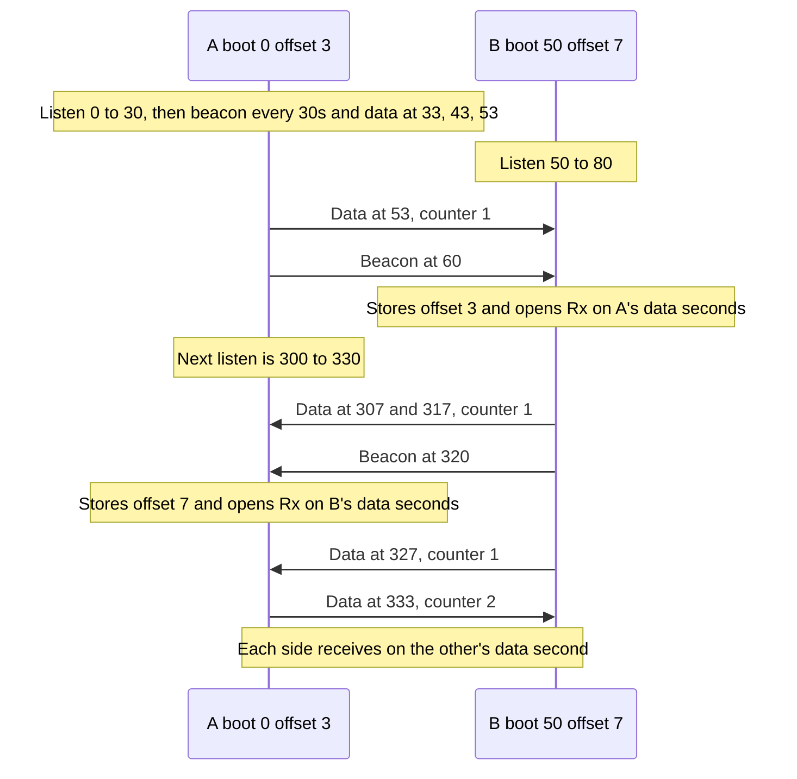

# Petri net examples

Two nets built with cpnpy. Each net has a state-space check and a Streamlit page. Plus the library Streamlit demo in `demo_net/`.

## Dining philosophers

Five philosophers share five forks. A philosopher takes both neighboring forks in one step, eats, then puts both forks back. The net is in `dining_philosophers/`.

### Setup

The project virtualenv uses Python 3.10. From the project root:

```bash
python3.10 -m venv venv
venv/bin/pip install -r requirements.txt
```

`requirements.txt` installs `cpnpy` from the `add_features` branch of https://github.com/GRpro/cpn-py, plus `networkx` and `streamlit`.

To use a local checkout of the library instead, comment out the Git line in `requirements.txt` and uncomment:

```text
-e /Users/grygorii/Documents/Projects/cpn-py
```

Keep only one of those two `cpnpy` lines active, then run `venv/bin/pip install -r requirements.txt` again.

### State space

```bash
venv/bin/python dining_philosophers/dining_philosophers.py
```

The script builds the reachability graph and checks mutual exclusion, 1-safety, deadlock freedom, and that every `take` and `put` stays live. The process exits with an error if a check fails. The printout does not claim starvation freedom.

### Visualizer

```bash
venv/bin/streamlit run dining_philosophers/visualize.py
```

Streamlit opens a browser page with the net. In the sidebar, under Step, pick a transition such as `take_0` and click **Fire selected transition**. `take_i` moves the philosopher from `think_i` onto `eat_i` and clears the two forks. `put_i` does the reverse.

A saved layout is in `dining_philosophers/dining-philosophers-graph-layout.json`. Use **Import graph layout** in the sidebar to load it.

## Radio beacons

Two radios boot at different times. Each radio is one token. It moves from `Sleep` to `Tx` to send, or to `Rx` to listen. `Hear` and `Receive` leave it there. `EndTx` and `EndRx` return it to `Sleep`, or to `Rx` for the next listen second. The net is in `radio_beacon/`.

It listens for 30 seconds every 300 seconds, the first time at boot. After that listen it sends a beacon every 30 seconds and data every 10 seconds, and it sleeps between those sends. A beacon on the same second as data wins, and that data send is skipped.

The beacon carries an offset from 1 to 10, the delay until the next data send. The radio in `Rx` stores that offset when it hears the beacon. A later beacon stores the same one. Only that listener learns the offset. It then opens `Rx` on the peer's data second.

With A booting at 0 (offset 3) and B at 50 (offset 7), the listens catch each other's beacons on different cycles. B learns A's data second during the first listen. A learns B's during the listen that starts at 300. After both beacons have been heard, each radio opens `Rx` on the other's data second.



`Receive` writes into `Message` when the sender is in `Tx` and the receiver is in `Rx` on that second. The discovery listen is that window too, so a radio records data heard there before the beacon arrives. `Message` stores one hop, `txNode` to `rxNode`, and the counter that was sent.

The counter on the radio moves only after both radios have heard each other. Until then every hop stays at counter 1, and the sender keeps transmitting that same counter. The hop on which both beacons are already heard still shows the counter that was sent. The next data send carries the next counter, and that sender then waits. For boots at 0 and 50, A's later listen records `B` to `A` at counter 1, including the hop just after A's beacon, and the following send is `A` to `B` at 2.

The radio token stores the second it is due. It has no boot field and no text field. Each output arc delays it until the next second. The first timestamp is the boot.

### State space

```bash
venv/bin/python radio_beacon/ssa.py
```

The script checks two startup draws with the state-space tool. Each draw stops at 400 seconds. The process exits with an error if a radio sits in two places at once, if a radio stores an offset it did not hear in `Rx`, or if the counter climbs before both beacons have been heard. Boots one second apart let only B hear A, so every hop is `A` to `B` at counter 1. Boots at 0 and 50 let each radio hear the other. The counter stays 1 through the hop just after the later beacon, and the next send is what climbs. The first record in `Message` names the radio that was in `Rx` for the first data send.

### Visualizer

```bash
venv/bin/streamlit run radio_beacon/visualize.py
```

The page starts with both radios in `Sleep`. Radio A boots at 0 with offset 3. Radio B boots at 50 with offset 7. Fire the enabled transition. A radio moves into `Rx` for a listen and into `Tx` to send. `EndTx` or `EndRx` moves it on. `Message` gains one hop, `txNode` to `rxNode`, when `Receive` fires.

## Library demo

`demo_net/streamlit_demo.py` is the cpnpy visualizer example. It shows integer, string, boolean, record, and list tokens, with timed and untimed transitions.

```bash
venv/bin/streamlit run demo_net/streamlit_demo.py
```

